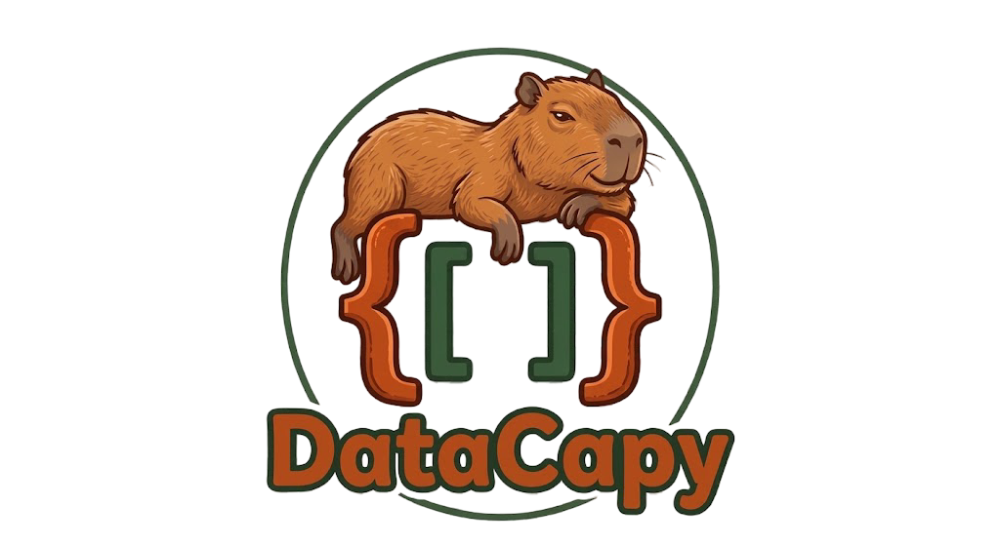

<!-- cspell:ignore elemMatch -->
<p align="center">
  
</p>

# DataCapy

**A document-first TypeScript framework for structured Node.js backends.**

Write one class and a config block, and get a validated, access-controlled, typed REST endpoint
backed by a choice of databases and served over a choice of Node.js HTTP servers. Datasource and HTTP adaptors keep your services independent of both, so you can change either without rewriting them. MySQL and MongoDB, and Express and Hono, are supported today.

DataCapy is document-first, not relational. You model documents, as a constructor class and its
schema, rather than tables, and each [datasource](docs/datasources.md) maps them onto its own
storage. MongoDB stores documents natively; MySQL is the relational datasource today.

- **One class, one schema.** A tagged TypeScript class generates the schema that validates on the
  server and in the browser. A build-time check fails if the two drift apart.
- **One query language.** The same MongoDB-style filters run on MySQL and MongoDB, so swapping the
  datasource in config does not change your queries. See the [query surface](docs/query-surface.md)
  for the supported operators.
- **Deny by default.** Nothing is reachable until you declare an endpoint. Each request is cast,
  validated and access-checked before your code runs, and typed errors map to HTTP statuses.
- **Typed documents and relations.** Repositories return instances of your classes, methods included.
  Relations load in one call and can span datasources.
- **Easy to test.** Seed an in-memory datasource and run a service without a database. The mock
  serves reads; it does not keep writes.

## Install

```bash
pnpm add @datacapy/server @datacapy/schema express
pnpm add -D @datacapy/codegen tsx typescript @types/express @types/node
```

Express is an optional peer dependency of `@datacapy/server`, so install it yourself (or use Hono, see
[HTTP adaptors](package/server/docs/http-adaptor.md)). Add the driver for your database (`mysql2` or
`mongodb`) to your own project. Licensed under [BSD 3-Clause](LICENSE).

## A taste

```ts
/** @schema note */
export class Note extends SchemaConstructor<Note> {
  _id?: string
  text!: string & t.Trim & t.MinLength<1> & t.MaxLength<280>
  status!: ('draft' | 'published') & t.Required & t.Default<'draft'>
}

class RepoNote extends Repo<Note> {
  constructor() {
    super({ name: 'note', dataSource: 'db' })
  }
}

/** @endpoints note */
class ServiceNote extends Service {
  constructor() {
    super({ name: 'note' })
  }

  /**
   * @route get /:id
   * @acl authed
   */
  async get({ id }: { id: string & e.Param }) {
    const note = await this.getRepo<RepoNote>('note').findOne({ _id: id })
    if (!note) throw new ServerErrorNotFound({ message: 'No such note' })
    return note
  }
}
```

Type tags on the class carry the validation rules, and `@endpoints`, `@route` and `@acl` on the
service say what is exposed, at which path and for which role. `datacapy-gen` writes the schema and
the endpoint config from them. The result:

```
GET /api/note/n1   (no credentials)   401 {"name":"ServerErrorUnauthorized"}
GET /api/note/n1   (signed in)        200 {"_id":"n1","text":"Hello","status":"published"}
GET /api/note/n9   (signed in)        404 {"message":"No such note","name":"ServerErrorNotFound"}
```

The full working version, with every file, the generate step and the server to run, is
[Getting started](docs/getting-started.md). To run it without a database, see
[Try it with no database](docs/try-without-database.md).

## Start where you are

Every layer is its own package, so you can adopt the whole stack or just the part you need.

| Package                                          | Use it when you want to                                                               |
| ------------------------------------------------ | ------------------------------------------------------------------------------------- |
| [`@datacapy/om`](package/om/README.md)           | Store and query data through repositories, with relations, encryption and datasources |
| [`@datacapy/server`](package/server/README.md)   | Expose services as REST endpoints with request validation and access control          |
| [`@datacapy/schema`](package/schema/README.md)   | Define, cast, filter and validate data once, in Node and the browser                  |
| [`@datacapy/codegen`](package/codegen/README.md) | Generate schemas and endpoint configs from tagged classes                             |
| [`@datacapy/migrate`](package/migrate/README.md) | Change a database over time with versioned patches and a dry-run mode                 |
| [`@datacapy/id`](package/id/README.md)           | Generate short, time-ordered Base62 IDs (15 characters)                               |

## Documentation

- [Getting started](docs/getting-started.md): one example through every layer
- [Datasources](docs/datasources.md): MongoDB, MySQL and the mock, and how MySQL maps documents
- [Query surface](docs/query-surface.md): supported operators and grouping
- [Try it with no database](docs/try-without-database.md)
- [Guides](docs/guides.md): per-package deep dives
- [Developing DataCapy](docs/development.md) and [Releasing](docs/releasing.md)
- [Workspace install](docs/workspace-install.md): use a git checkout instead of npm

## License

[BSD 3-Clause](LICENSE)
